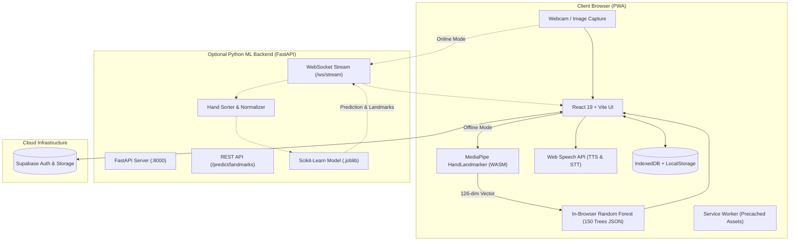

# 🤟 HandSpeak

> **Accessible, Offline-First Indian Sign Language (ISL) Translation, Learning, and Community Platform**

[](https://vitejs.dev/)
[](https://react.dev/)
[](https://fastapi.tiangolo.com/)
[](https://developers.google.com/mediapipe)
[](https://web.dev/progressive-web-apps/)
[](./LICENSE)

---

## 📖 Table of Contents

- [Overview](#-overview)
- [Key Features](#-key-features)
- [System Architecture](#-system-architecture)
- [Tech Stack](#-tech-stack)
- [Project Structure](#-project-structure)
- [Getting Started](#-getting-started)
  - [Prerequisites](#prerequisites)
  - [Frontend Setup](#1-frontend-setup)
  - [Optional ML Backend Setup](#2-optional-ml-backend-setup)
- [Environment Variables](#-environment-variables)
- [Machine Learning Pipeline](#-machine-learning-pipeline)
  - [Landmark Extraction & Normalization](#landmark-extraction--normalization)
  - [Dual-Engine Inference (Offline vs Cloud)](#dual-engine-inference)
  - [Browser Parity & Export](#browser-parity--export)
- [Offline-First & PWA Capabilities](#-offline-first--pwa-capabilities)
  - [Offline Verification Checklist](#offline-verification-checklist)
- [API Reference](#-api-reference)
- [Contributing](#-contributing)
- [License](#-license)

---

## 🌟 Overview

**HandSpeak** is a full-featured, accessible web platform engineered to bridge the communication barrier between Deaf/Hard-of-Hearing individuals and hearing society. HandSpeak provides two-way translation for **Indian Sign Language (ISL)**, gamified learning challenges, multilingual voice synthesis (English & Marathi), and community links with verified deaf-welfare organizations.

Designed with an **offline-first philosophy**, HandSpeak runs real-time computer vision and machine learning models directly inside client web browsers via WebAssembly and MediaPipe. Even in areas with limited or no internet access, users can translate gestures, test their sign skills, and track learning progress on desktop and mobile devices alike.

---

## ✨ Key Features

### 1. 📹 ISL ➔ Text & Speech (Live Translator)
- **Real-Time Webcam Detection**: Low-latency sign recognition with live hand skeleton overlay (color-coded joints and bones).
- **Dual Inference Engine**:
  - **Client-Side Browser ML**: Runs a 150-tree Random Forest classifier directly in JavaScript using `@mediapipe/tasks-vision` (zero network latency, completely offline).
  - **Server-Side WebSocket**: Optional streaming backend (`/ws/stream`) with sub-150ms latency and REST fallback (`/predict/image`, `/predict/landmarks`).
- **Multilingual Support**: Real-time sign translation with English alphabet, Marathi script, phonetic pronunciation, and example Marathi vocabulary.
- **Word Spelling Buffer**: Assemble individual signs into full words, with backspace, word spacing, and one-click voice pronunciation.
- **Audio Output**: Integrated Web Speech API (`mr-IN` / `en-IN`) for immediate voice synthesis.
- **Static Photo Upload**: Drag-and-drop or upload images for instant posture analysis.

### 2. 🔤 Text & Voice ➔ ISL (Reverse Translation Engine)
- **ISL Grammar & SOV Syntax Reordering**: Automatically translates English SVO sentence structure into authentic Indian Sign Language grammar (Subject-Object-Verb), placing question words at the sentence end and pruning non-manual auxiliary words per ISL linguistic standards.
- **Lexicon & Word-Level Signs**: Directly recognizes authentic holistic ISL signs (Greetings, Emergency terms, Pune regional signs, Essentials) with Marathi script and phonetic pronunciation.
- **Full 0-9 Digits & Fingerspelling**: Supports numeric signs (0–9) and finger gesture cards (A–Z) with contextual word boundary tracking.
- **ISLTranslate & iSign Dataset Integration**: Benchmarked against 31,220+ authentic sentence pairs from the ACL 2023 **ISLTranslate** and ACL 2024 **iSign** datasets, complete with one-click quick-practice phrase chips.
- **Comprehensive Interactive Playback**: Play, Pause, Resume, Reset, Step Forward (⏭), Step Backward (⏮), speed controls (Slow 1.2s, Normal 0.75s, Fast 0.4s), interactive timeline ribbon (click any sign to inspect), and dual-language TTS voice pronunciation.
- **Speech-to-Text**: Hands-free voice recognition input with real-time ISL parsing using the Web Speech API.

### 3. 🎯 Gamified Speed Quiz Game
- **Interactive Practice**: Real-time challenges prompting the user to perform randomized signs under a countdown clock.
- **Real-Time Pose Grading**: Evaluates user postures via webcam and awards points based on speed and accuracy.
- **Streak & Score Tracking**: Tracks daily practice streaks, highest scores, average accuracy, and personal best milestones.
- **Synchronous Offline Save**: Quiz attempts and performance histories are preserved immediately in IndexedDB and local storage.

### 4. 📊 Learner & Organization Dashboard
- **Personalized Analytics**: Visual progress dashboard showing daily streak, total signs mastered, quiz attempts, and average accuracy.
- **Recent Quiz History**: Live-updating chronological log of recent quiz sessions with dynamic personal best badges.
- **Role-Based Views**:
  - **Learners**: Progress statistics, practice history, and affiliated partner organizations.
  - **Organizations**: Community overview, enrolled member tallies, and deaf-learner outreach statistics.

### 5. 🏛️ Partner Organisations Directory
- **Accredited Directory**: Explore verified Indian deaf-welfare bodies (e.g., ISLRTC, National Association of the Deaf, AIFD, PAD).
- **Direct Contact Info**: Verified phone numbers (`tel:`), email addresses (`mailto:`), and physical headquarters locations.
- **One-Click Enrollment**: Seamlessly register with or leave mentoring partner organizations.

### 6. 📱 Progressive Web App (PWA) & Offline Mode
- **Installable Desktop/Mobile App**: Certified PWA built with service worker precaching for the app shell, fonts, and model assets.
- **Self-Hosted Assets**: Bundled `DM Sans` and `Fraunces` variable typography without runtime Google Fonts requests.
- **Offline Session Persistence**: IndexedDB session recovery keeps learners logged in even when connectivity drops.

---

## 🏗️ System Architecture



---

## 💻 Tech Stack

### Frontend
- **Framework**: [React 19](https://react.dev/) + [Vite 8](https://vitejs.dev/)
- **Routing**: [React Router v7](https://reactrouter.com/)
- **Styling**: Modular CSS (CSS Modules), CSS variables for Dark/Light theme switching
- **Computer Vision**: [`@mediapipe/tasks-vision`](https://www.npmjs.com/package/@mediapipe/tasks-vision)
- **Local Database**: [`idb`](https://www.npmjs.com/package/idb) (IndexedDB wrapper)
- **PWA Runtime**: [`vite-plugin-pwa`](https://vite-pwa-org.netlify.app/) (Workbox)
- **Typography**: `@fontsource-variable/dm-sans`, `@fontsource-variable/fraunces`

### Backend (Optional Inference Server)
- **Web Framework**: [FastAPI](https://fastapi.tiangolo.com/), [Uvicorn](https://www.uvicorn.org/)
- **Machine Learning**: [Scikit-learn](https://scikit-learn.org/), [NumPy](https://numpy.org/), [Joblib](https://joblib.readthedocs.io/)
- **Vision Processing**: [MediaPipe](https://developers.google.com/mediapipe), [OpenCV Python](https://opencv.org/)
- **WebSockets**: Native FastAPI WebSocket streaming with async connection management

### Cloud & Database
- **Authentication**: [Supabase Auth](https://supabase.com/) with offline cached profile normalization

---

## 📁 Project Structure

```text
SignLang_final/
├── public/                       # Static public assets
│   ├── assets/signs/             # Visual ISL reference images (A-Z)
│   ├── favicon.ico, pwa-*.png    # PWA icons & web manifest
│   └── models/                   # Browser-exported ML model & weights
├── src/
│   ├── components/               # Shared reusable components
│   │   ├── Navbar/               # Responsive header & theme toggle
│   │   ├── Footer/               # Platform footer & social navigation
│   │   ├── OnlineStatus/         # Live network state pill
│   │   └── ProtectedRoute.jsx    # Authentication route guard
│   ├── context/                  # React Context providers
│   │   ├── AuthContext.jsx       # Supabase auth & persistent user state
│   │   └── ThemeContext.jsx      # Dark/Light theme toggle provider
│   ├── layouts/
│   │   └── DashboardLayout/      # Sidebar & app shell for authenticated views
│   ├── lib/                      # Core business logic & storage
│   │   ├── supabaseClient.js     # Supabase initialization
│   │   ├── offlineDb.js          # IndexedDB manager & quiz history merger
│   │   ├── offlineClassifier.js  # In-browser Random Forest inference engine
│   │   ├── organizations.js      # Accredited organisations registry
│   │   └── islDictionary.js      # ISL vocabularies & phonetic mappings
│   ├── pages/                    # Application route views
│   │   ├── LandingPage/          # Public marketing & feature overview
│   │   ├── AuthPage/             # Sign-in, sign-up, and password recovery
│   │   ├── DashboardPage/        # Learner analytics & organisation cards
│   │   ├── TranslatePage/        # Live ISL-to-Text & skeleton visualizer
│   │   ├── ReverseTranslatePage/ # Text-to-Sign animation engine
│   │   ├── SpeedQuiz/            # Real-time gamified signing test
│   │   └── OrganizationsPage/    # Searchable organisation directory
│   ├── App.jsx                   # Route declarations
│   └── main.jsx                  # Application entry point
├── ml_backend/                   # Optional Python FastAPI service
│   ├── app/
│   │   ├── main.py               # FastAPI application & WebSocket routes
│   │   ├── predictor.py          # MediaPipe + Random Forest inference
│   │   └── schemas.py            # Pydantic request/response schemas
│   ├── models/                   # Saved .joblib model files & label maps
│   ├── scripts/                  # Data collection & model export tools
│   │   ├── collect_data.py       # Capture training images via webcam
│   │   ├── extract_features.py   # Extract 126-dim landmarks to CSV
│   │   ├── train_model.py        # Train Random Forest classifier
│   │   ├── export_model.py       # Export scikit-learn model to browser JSON
│   │   └── test_browser_parity.py# Verify Python vs JS inference parity
│   └── requirements.txt          # Python dependencies
├── package.json                  # Node dependencies & build scripts
├── vite.config.js                # Vite & PWA configuration
└── README.md                     # Documentation
```

---

## 🚀 Getting Started

### Prerequisites
- **Node.js**: v18.0.0 or higher
- **npm**: v9.0.0 or higher
- *(Optional for ML Backend)*: **Python**: 3.10+ and a virtual environment tool

---

### 1. Frontend Setup

1. **Clone the repository:**
   ```sh
   git clone https://github.com/your-username/SignLang_final.git
   cd SignLang_final
   ```

2. **Install frontend dependencies:**
   ```sh
   npm install
   ```

3. **Configure environment variables:**
   Create a `.env` file from the provided template:
   ```sh
   cp .env.example .env
   ```
   *(See [Environment Variables](#-environment-variables) for configuration options).*

4. **Start the local Vite development server:**
   ```sh
   npm run dev
   ```
   Open your browser at `http://localhost:5173`.

---

### 2. (Optional) ML Backend Setup

> [!NOTE]
> The backend is entirely optional. If not running, HandSpeak will automatically fallback to **in-browser offline inference** without any configuration!

1. **Navigate to the backend directory and activate a virtual environment:**
   ```sh
   cd ml_backend
   python -m venv venv

   # On Windows:
   .\venv\Scripts\activate
   # On macOS/Linux:
   source venv/bin/activate
   ```

2. **Install Python dependencies:**
   ```sh
   pip install -r requirements.txt
   ```

3. **Start the FastAPI service:**
   ```sh
   uvicorn app.main:app --host 127.0.0.1 --port 8000 --reload
   ```
   The backend will be live at `http://127.0.0.1:8000`. You can inspect interactive API documentation at `http://127.0.0.1:8000/docs`.

---

## ⚙️ Environment Variables

Create a `.env` file in the root directory:

```env
# ===================================================
# HandSpeak Configuration
# ===================================================

# (Optional) Remote/Local FastAPI Server
# Omit both to run 100% in-browser offline inference
VITE_API_BASE=http://127.0.0.1:8000
VITE_WS_URL=ws://127.0.0.1:8000/ws/stream

# (Optional) Supabase Authentication
# Provides online cloud account registration and login
VITE_SUPABASE_URL=https://your-project.supabase.co
VITE_SUPABASE_ANON_KEY=your-supabase-anon-key
```

---

## 🌐 Deploying to Render via Docker

HandSpeak includes a production-ready multi-stage [`Dockerfile`](./Dockerfile) and a Render Blueprint ([`render.yaml`](./render.yaml)) that bundles the **React 19 PWA** and the **FastAPI ML backend** into a **single, unified container**. This allows you to host the complete application on Render's free tier with zero CORS issues and a single public domain.

### Method 1: 1-Click Render Blueprint (Recommended)

1. Push your latest code to your GitHub repository.
2. Log in to [Render Dashboard](https://dashboard.render.com/).
3. Click **New +** > **Blueprint**.
4. Select your `SignLang_final` repository.
5. Render will automatically detect `render.yaml` and configure:
   - **Environment**: Docker
   - **Dockerfile**: `./Dockerfile`
   - **Health Check Path**: `/health`
   - **Plan**: Free
6. (Optional) Under environment variables, enter your `VITE_SUPABASE_URL` and `VITE_SUPABASE_ANON_KEY`.
7. Click **Apply**. Render will build and deploy your app with its own HTTPS URL (e.g., `https://handspeak.onrender.com`).

---

### Method 2: Manual Web Service Setup

If you prefer configuring the Web Service manually on Render:

1. Click **New +** > **Web Service**.
2. Connect your GitHub repository.
3. Configure the settings:
   - **Name**: `handspeak`
   - **Region**: Choose the closest region (e.g., *Oregon* or *Frankfurt*)
   - **Language / Runtime**: **Docker**
   - **Dockerfile Path**: `./Dockerfile`
   - **Docker Build Context**: `.`
   - **Instance Type**: **Free**
4. Under **Health Check Path**, enter: `/health`
5. Under **Environment Variables**, add:
   - `PORT`: `10000`
   - `VITE_SUPABASE_URL`: *(your Supabase project URL)*
   - `VITE_SUPABASE_ANON_KEY`: *(your Supabase anon key)*
6. Click **Create Web Service**. Render will execute the multi-stage build and launch the app!


---

## 🧠 Machine Learning Pipeline

### Landmark Extraction & Normalization
1. MediaPipe detects up to **2 hands**, identifying **21 landmarks** per hand in 3D space $(x, y, z)$.
2. Hands are sorted geometrically from left to right based on the wrist coordinates ($x_0$), avoiding left/right hand flipping ambiguity.
3. Coordinates are translated relative to the wrist and scaled by the hand's bounding box to ensure translation- and scale-invariance.
4. If only one hand is detected, the second hand is zero-padded, producing a constant **126-dimensional feature vector** $(2 \times 21 \times 3)$.

### Dual-Engine Inference
```text
           ┌─── [Backend Reachable] ──> FastAPI WebSocket (:8000) ──> Python Random Forest
Webcam ────┤
           └─── [Offline / Standalone] > MediaPipe WASM (Client) ────> Browser Random Forest (JS)
```

### Browser Parity & Export
When you retrain the Random Forest model in Python, export the decision trees into a JSON format for the browser:

```sh
# 1. Export scikit-learn model to public/models/
python ml_backend/scripts/export_model.py

# 2. Run feature extraction and parity verification
python ml_backend/scripts/test_browser_parity.py
```
This guarantees identical numerical features, branch traversals, and class probabilities between Python and JavaScript.

---

## 📶 Offline-First & PWA Capabilities

HandSpeak satisfies modern Progressive Web App (PWA) requirements:
- **Service Worker Precaching**: Precaches HTML, JavaScript bundles, CSS, fonts, and sign icon assets.
- **Lazy Model Caching**: On the first visit to `/translate`, the 35 MB MediaPipe WASM and landmark detection assets are downloaded and saved to the Cache Storage API (`handspeak-offline-model-assets`).
- **Resilient Storage**: Quiz results, settings, and profile data are backed up to both **IndexedDB** and **LocalStorage**.

### Offline Verification Checklist
You can verify the complete offline functionality of the app with this checklist:

- [ ] **Build & Preview**: Run `npm run build` followed by `npm run preview`.
- [ ] **Install PWA**: Click the Install icon in the browser address bar.
- [ ] **Preload Models**: Navigate to `/translate`, enable the camera or upload a photo once to let the offline model assets download. Confirm the *"Ready for offline use"* badge appears.
- [ ] **Simulate Offline**: Open Chrome DevTools > **Network** tab > choose **Offline**.
- [ ] **Verify Routes**: Navigate across `/dashboard`, `/translate`, `/reverse-translate`, `/speed-quiz`, and `/organizations`. All routes should load without error.
- [ ] **Take a Quiz Offline**: Play a round in `/speed-quiz`. Confirm score and attempts are logged on `/dashboard`.

---

## 📡 API Reference

When running the Python ML Backend, the following endpoints are exposed:

| Method | Endpoint | Description |
|---|---|---|
| `GET` | `/health` | Server health check and model loading status |
| `GET` | `/labels` | Returns all supported sign classes and Marathi translations |
| `POST` | `/predict/image` | Accepts a multipart image file and returns prediction and landmarks |
| `POST` | `/predict/landmarks` | Low-latency endpoint accepting a 126-float array |
| `WS` | `/ws/stream` | Full-duplex WebSocket stream for real-time video frames (150ms interval) |

---

## 🤝 Contributing

Contributions are welcome to help expand Indian Sign Language accessibility!

1. Fork the Project
2. Create your Feature Branch (`git checkout -b feature/AmazingFeature`)
3. Commit your Changes (`git commit -m "feat: add AmazingFeature"`)
4. Push to the Branch (`git push origin feature/AmazingFeature`)
5. Open a Pull Request

---

## 📄 License

Distributed under the **MIT License**. See [`LICENSE`](./LICENSE) for more information.

---

<p align="center">
  Built with ❤️ for an inclusive, barrier-free world.
</p>
